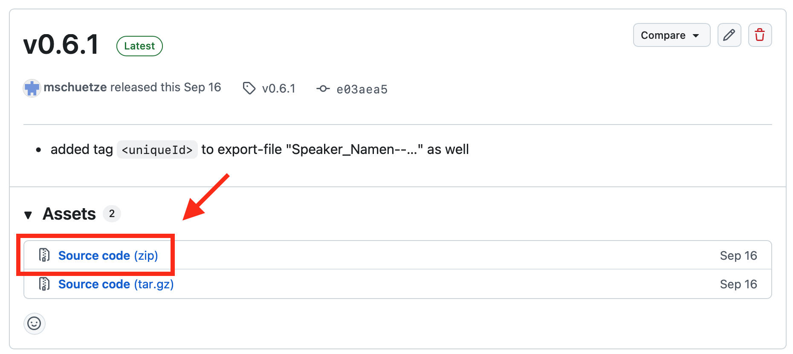

# conferenceTransform

`conferenceTransform` verarbeitet Konferenzdaten im XML-Format und erzeugt daraus XML-Dateien für den Import in diversen Apps.

## Funktionsumfang

- Führt alle XML-Dateien (`*.xml`) aus einem Eingabeordner zu einem gemeinsamen Datenbestand zusammen (Kombi-Konferenzen).
- Bereinigt HTML-Tags und bestimmte HTML-Entities in Beschreibungen.
- Filtert Sessions anhand ihres Startzeitpunkts auf einen angegebenen Zeitraum und sortiert die Einträge.
- Erzeugt bis zu 20 XML-Ausgabedateien: Namenslisten, Keynotes, Sessions und Workshops in unterschiedlichen Varianten (mit/ohne Datum und Raum), Social-Media-Varianten sowie Tabellen für Raum- und Zeitpläne.

## Voraussetzungen

- Java herunterladen + installieren: [Eclipse Temurin 8 herunterladen](https://adoptium.net/temurin/releases/?version=8)
  - Auf der Seite die folgenden Optionen auswählen:
    - **Operating System:** `macOS`
    - **Architecture:** `aarch64` für einen Mac mit Apple-Chip oder `x64` für einen Intel-Mac. 
    - **Package Type:** `JDK`
    - Download startet.

## Installation

1. Neueste Version des Tools herunterladen (ZIP): https://github.com/mschuetze/conferenceTransform/releases
   
2. ZIP entpacken und in beliebigen Ordner (z.B. Schreibtisch) kopieren/verschieben.
3. fertig.

## Benutzung

1. Konferenz-XML herunterladen und ablegen siehe Manual. 
2. Ordner "conferenceTransform" im Finder öffnen.
3. XML-Datei(en) in Unterordner `input` kopieren. Vorher alte Dateien im Ordner löschen.
4. Datei `start_conferenceTransform` öffnen und per PLAY-Button (oben rechts) ausführen.
5. Fertige Dateien landen in Unterordner `indesign-out`.

## Aktualisieren

1. siehe [Installation] https://github.com/mschuetze/conferenceTransform#installation
2. alten Ordner `conferenceTransform` löschen.